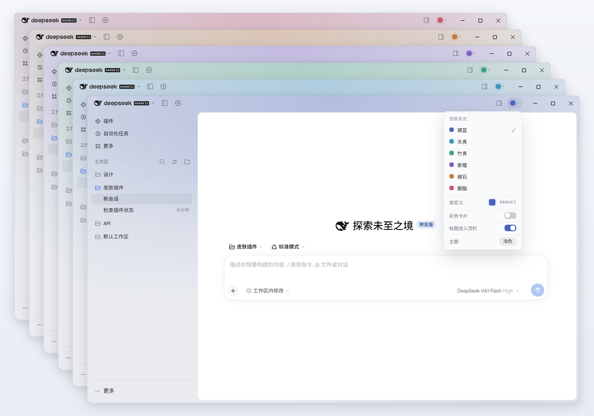
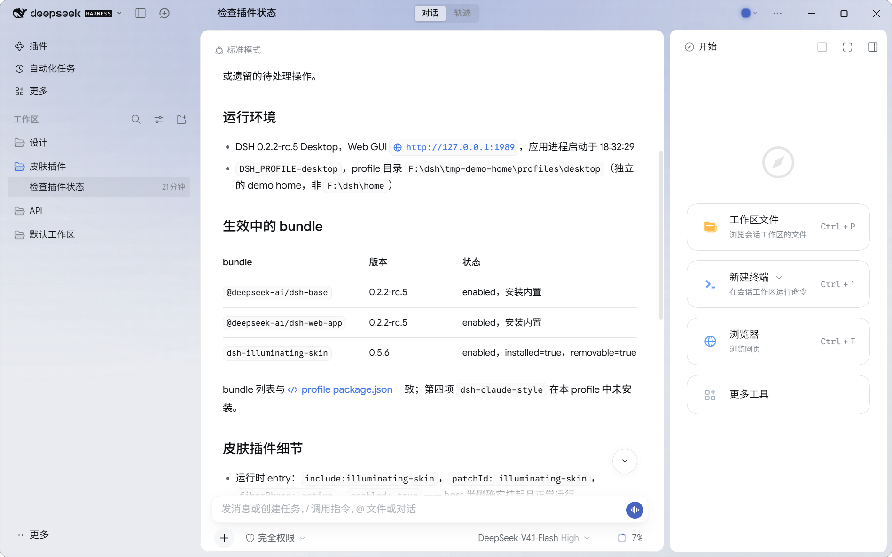

# dsh-illuminating-skin

**IntelliJ IDEA 风格的 DeepSeek Harness 毛玻璃皮肤。** 左栏与窗口标题栏连成一整块玻璃，标题栏中央透出可换色的光；主栏是四周留缝的圆角卡片；设置、搜索、菜单、提示框等浮层统一磨砂。深色、浅色主题都有对应配色。

`DSH 0.2.2-rc.5` ｜ `GPL-3.0` ｜ 可选搭配 `dsh-claude-style >= 0.19.0`





---

## 两种使用方式

从 0.5.0 起，本插件可以独立使用，不再要求安装 [dsh-claude-style](https://www.npmjs.com/package/dsh-claude-style)。插件会自动判断当前环境：

| | 独立使用 | 搭配 dsh-claude-style |
| --- | --- | --- |
| 布局 | 由本插件负责：会话标题、视图标签和工具按钮放进窗口标题栏，主栏为圆角卡片 | 主体布局由 claude-style 负责（本插件改配色）；Windows 标题栏左侧的品牌下拉、搜索与新会话按钮组同样由本插件统一接管 |
| 输入框 | 本插件重绘：单行输入条，工具行在下方 | claude-style 重绘的输入框 |
| 左栏排布 | 紧凑：行更矮、间距更小，同样高度能显示更多会话 | claude-style 的布局（宽松 / 紧凑在它的设置里选） |
| 上下文占用环、消息导航 | 宿主自带组件，改用发光色；占用环移到模型选择右侧 | claude-style 的版本 |
| 外观菜单 | 多一个「标题进入顶栏」开关 | 无此开关 |

搭配 claude-style 时，请在它的设置里把「配色」改为**跟随宿主**。启用或停用 claude-style 后，皮肤会自动切换到对应的方式，不需要重装。

---

## 安装

### 从 GitHub

```bash
dsh plugin --profile desktop add github:ExTetragon/dsh-illuminating-skin
```

### 从本地目录

```bash
dsh plugin --profile desktop add link:/absolute/path/to/dsh-illuminating-skin
```

> **Windows 桌面端**：desktop profile 只能用桌面端自带的命令行管理插件，路径类似
> `%LOCALAPPDATA%\Programs\DeepSeek Harness\resources\runtime\cli\bin\dsh.cmd`。
> 用 npm 全局安装的 `dsh` 会拒绝操作 desktop profile。

安装后**重启 DeepSeek Harness 桌面端**生效。

> 任何一个插件加载失败都会让桌面端回退到只含核心组件的配置（旧配置备份在 `cordis.patch.yml.bak-*`）。建议一次只装一个主题插件，装完立即重启确认。

---

## 效果

| 区域 | 效果 |
| --- | --- |
| 左栏与标题栏 | 整列侧栏和窗口标题栏是同一块玻璃，中间没有接缝；标题栏中央透出一团主题色的光，向两侧和下方逐渐淡去 |
| 品牌标签与应用菜单（Windows） | 独立使用与搭配 `dsh-claude-style` 时外观统一：DeepSeek Harness 品牌标签移到标题栏最左侧，点击展开「应用 / 编辑」下拉（原生菜单从下拉项右侧弹出），标题栏上原来的两个菜单收起；装了 ds-bot 时，下拉最上方多一项「DS-Bot模式」（代替 claude-style 提供的左上角界面切换按钮），点击回到 bot 界面。其右依次是收起左栏、（`cs` 模式下）搜索、新会话图标按钮；收起左栏前后位置不变，悬停提示与快捷键样式统一，左栏内原有的品牌区与重复搜索入口同步收起，主栏会话名紧跟按钮组之后 |
| 顶栏搜索按钮（搭配 dsh-claude-style、Windows） | 启用 `dsh-claude-style` 时，标题栏「收起左栏」与「新会话」之间固定放置一个搜索按钮（收起前后位置不变），点击触发 claude-style 的搜索面板 |
| 紧凑左栏（独立使用） | 参照 claude-style 的紧凑布局：新会话移进标题栏后，「插件」等入口从标题栏下方 12px 开始（`cs` 模式与 ds-bot 界面同样保持 12px 顶距）；入口行 30px、工作区与会话行 28px，字号降一档，分组之间只留细缝；底部账号区上方加一条分隔线。其他插件放在左栏底部的按钮保持原样 |
| 窗口按钮 | 最小化 / 最大化 / 关闭按钮的底色与标题栏融为一体，不再是一块单独的色块 |
| 主栏 | 四周留缝的圆角卡片，带一圈细描边；对话、阅读、轨迹、上下文等视图，以及插件、插件市场、自动化任务、记忆系统等页面都使用同一张卡片 |
| 右栏 | 打开时同样是圆角卡片，与主栏上下对齐；内部面板不再各自套一层边框 |
| 浮层 | 设置面板、Ctrl+K 搜索、菜单、悬浮卡片、提示框、通知、浮动窗口统一为磨砂玻璃；浅色主题下提示框文字为深色 |
| 视图标签 | 对话 / 阅读 / 轨迹 / 上下文 / 统计这排标签固定显示在标题栏中央，不随鼠标位置淡入淡出；顶栏「更多对话视图（`···`）」菜单隐藏「浏览更多插件 / 创建你的插件」，全部视图已展示时自动隐藏 `···` 按钮（左栏「更多」菜单保持原样） |
| 输入框（独立使用） | 一条带浮雕的圆角单行输入条，文字、多行草稿和附件都在条内，向上长高；附件、权限、模型等工具排在输入条下方一行，窗口变窄时计费等附加项先让位。输入条上方有一小段渐变缓冲，对话滚到这里淡出。提交按钮在输入条右下角，使用发光色：没有内容时是声波图标，有内容时弹出箭头。聚焦时输入条描边与外圈光晕也是发光色。轮次、速度、缓存命中这一行统计不再显示。新会话首页的大输入框保持宿主样式 |
| 语音输入 | 启用宿主内置的语音输入插件时，麦克风按钮放在输入条内、提交按钮左侧（圆形），宿主工具行里原来的麦克风隐藏；点击行为与宿主完全一致（录音、停止、设置引导都由宿主处理），录音时按钮变红。停用该插件时不显示麦克风 |
| 上下文占用环与消息导航 | 占用圆环（独立使用时位于模型选择右侧）、对话右侧的消息导航条，当前项使用发光色 |
| 字体 | 界面英文用 Google Sans Flex（随插件内嵌），中文用系统自带的思源黑体（Noto Sans SC），代码用 Google Sans Code。字重按一套更细的阶梯：正文 350、强调 450、标题 550、加粗 650；宿主各组件原本写死的 400 / 500 / 600 / 700 会自动换算到这套阶梯。字号保持宿主原样 |
| 消息 | 发送消息时直接出现最终位置的气泡，不再先闪过一个半透明副本；入场为短暂的缩放淡入 |

## 外观菜单

标题栏右侧有一个色点按钮（插件页、自动化任务等没有会话的页面也有），悬停时提示「外观」，点开是一块玻璃菜单，从上到下依次是：

### 顶部发光

六套预设颜色，另有一行「自定义」可以用取色器任意选色，拖动时实时生效。选择会被记住，重启后保持。

| 预设 | 色值 |
| --- | --- |
| 黛蓝（默认） | `#4864C1` |
| 天青 | `#3894BE` |
| 竹青 | `#3E9E78` |
| 紫檀 | `#7E5CC4` |
| 赭石 | `#C47C3E` |
| 胭脂 | `#C2566E` |

标题栏光晕、卡片四周的缝隙、设置面板顶部的高光都跟着这个颜色变化。

### 彩色卡片

默认关闭。打开后，主栏和右栏卡片换成「主题色 + 底色」混合出的纯色：深色主题下是带一点主题色调的深色，浅色主题下是带一点主题色调的浅色。换发光颜色时卡片色调会一起变。卡片里的吸顶栏（插件页顶部、阅读视图的折叠条等）也会跟着变成卡片色。

### 标题进入顶栏

仅在独立使用、Windows 上显示，默认开启。开启时会话标题与主栏内容左对齐（窗口很窄时至少离菜单 16px），视图标签居中，工具按钮靠在窗口按钮左边；关闭后它们回到主栏卡片顶部的原位。窗口变窄时标题会自动截断，放不下的视图标签收进「···」。标题栏空白处仍可拖动窗口、双击最大化。

### 主题

右侧按钮显示当前主题，点击在三种之间循环：跟随系统 → 浅色 → 深色 → 跟随系统。从「跟随系统」第一次点击时，会切到与当前外观相反的那一种。

这里切换的是 DeepSeek Harness 本身的主题设置，原生标题栏、菜单和 claude-style 的配色会一起变化；在设置面板或系统里改了主题，按钮文字也会同步更新。

关闭菜单：点菜单外部、按 `Esc`，或再点一次色点按钮。

## ds-bot 界面

装了 [ds-bot](https://github.com/Fei2411/DS-Bot) 时，切换到 bot 界面后皮肤同样生效：

- 左栏、标题栏、窗口按钮仍是一整块玻璃，主栏只有一张卡片，与普通界面一致；
- 深色、浅色两套配色都会覆盖 ds-bot 自带的配色，文字保持清晰；
- 外观菜单按钮固定在标题栏里、窗口按钮左侧；
- 标题栏可以正常拖动窗口，双击可以最大化；
- 隐藏 claude-style 在左上角提供的界面切换按钮，改为统一由品牌下拉首项切换模式；
- Windows 下，左上角是 DeepSeek 鲸鱼 + 「DS Bot」品牌按钮，点击展开下拉：最上方「经典Agents模式」回到普通界面，其下是「应用 / 编辑」；其右依次是收起左栏、新建分组、搜索、新建四个按钮，左栏收起时也一直在标题栏里（收起时点新建分组等，会临时展开左栏完成操作再收回）；
- 会话标题放进标题栏，在左右两组按钮之间居中：单个 Bot 显示头像、名字和来源图标，群聊显示群头像和当前目标，悬停时群聊切换为群名，并出现打开详情的箭头；群聊的目标进度栏留在主栏顶部居中，可展开，打开右侧详情时随主栏重新居中；
- 左栏顶部那一行收进标题栏，Bot 列表上移；左栏收起时主栏卡片左右两侧留缝一致；
- 输入框与普通界面一致：单行输入条、浮雕、上方渐变缓冲，麦克风与提交按钮在输入条右下角；群聊没有内容时也显示声波状态的提交按钮；
- 「回到底部」按钮与普通界面相同。

退出 bot 界面后自动恢复普通界面的样式。

## 与其他插件的关系

- **dsh-claude-style**：可选。装了它时，主体布局与长会话由它负责、本插件只改配色；Windows 下标题栏左侧的品牌下拉、搜索与新会话按钮组同样由本插件统一接管，并隐藏它提供的界面切换按钮。
- **皮肤中心**：启用皮肤中心的任何皮肤时，本插件会自动让路，不会两套样式叠加。
- **dsh-better-display**：阅读视图的折叠条与主栏卡片同色。
- **dsh-better-sidebar**：右栏里的面板与右栏卡片融为一体。

## 已知限制

- **中文字体依赖本机**：中文使用系统里的思源黑体（Noto Sans SC，Windows 11 自带 `NotoSansSC-VF.ttf`）。没有装这个字体时，中文会回退到系统默认字体（如微软雅黑）。
- **插件体积变大**：DSH 页面只允许 `data:` 形式的字体，Google Sans Flex / Code 只能以 base64 内嵌，`lib/client.js` 约 500KB。
- **独立使用时输入框只重绘外观**：附件拖放、粘贴等行为仍由宿主处理，没有 claude-style 输入框的附加功能。
- **隐藏了 claude-style 的「聊天 / 代码」切换按钮**：在经典 Agent 与 DS-Bot 都存在时，请通过左上角品牌下拉菜单最上方的「DS-Bot模式」 / 「经典Agents模式」互相切换（Windows），或使用 ds-bot 自带入口。
- **标题栏整合只在 Windows 上生效**：macOS 下标题、标签保持宿主原位。
- **从 claude-style 切到独立使用后，它的长会话性能优化也随之停用**：会话很长时滚动可能不如之前流畅。
- **深色主题的部分页面复查较少**：近期修改主要在浅色主题下逐页验证，深色主题下的个别页面可能还有细节不一致。
- **ds-bot 适配依赖它当前的界面结构**：ds-bot 大幅改版后，bot 界面的部分样式可能失效，普通界面不受影响。
- **新出现的面板需要单独适配**：其他插件新增的自定义面板不会自动获得玻璃材质。

## 许可证

[GPL-3.0](./LICENSE)
